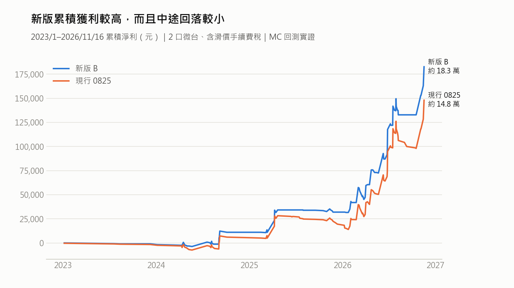
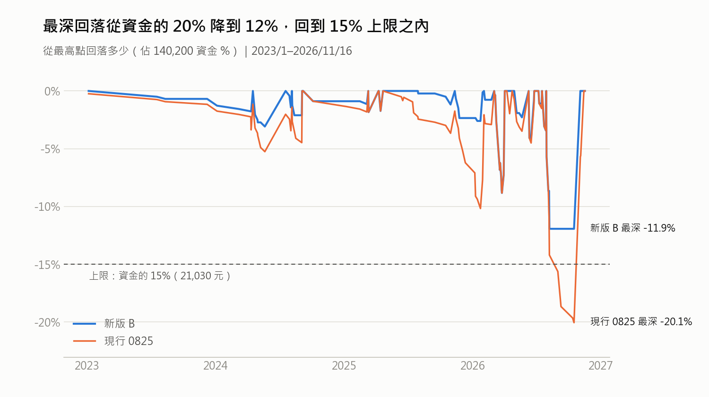
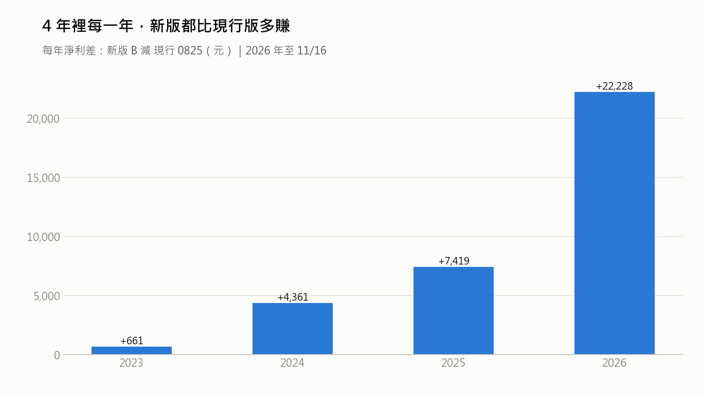

# S16 空方趨勢策略：優化結論與上線建議（2026-11-20）

> 狀態：**下單軟體 MC 回測實證**。11/19 跑，和電腦模擬逐筆核對完全一致。回測期間 2023/1～2026/11/16。

## 一句話
**新版只多一條進場規則：「現在的波動，要比過去 90 天同一時間點 7 成的時候都大」才進場。**

結果：
- 最深回落從資金的 20% 降到 12%
- 最長連續虧損從 9 筆降到 5 筆
- 每筆平均獲利多 69%
- 年化報酬從 27.2% 提高到 33.6%

停損、出場規則完全不變。

## 核心數字（2 口微台、資金 140,200、扣滑價手續費稅；2023/1～2026/11/16）

| | 現行版 | 新版 | 變化 |
|---|---|---|---|
| 年化報酬 | 27.2% | **33.6%** | +23% |
| 總淨利 | 148,015 元 | **182,684 元** | +23% |
| 每筆平均獲利 | 1,244 元 | **2,100 元** | +69% |
| 最深回落（佔資金） | 20.1% | **11.9%** | −41% |
| 最長連續虧損 | 9 筆、−20,112 元 | **5 筆、−9,077 元** | 筆數 −44%、金額 −55% |
| 勝率 | 30.3% | 39.1% | +8.8 個百分點 |
| 獲利因子（總賺 ÷ 總賠） | 2.31 | 3.34 | +45% |
| 每年交易次數 | 31 次 | 22 次 | −27% |

## 逐年績效（新版）

| 年 | 交易筆數 | 淨利 | 報酬率 | 每筆平均獲利 | 每 1 萬元每筆賺 | 勝率 | 獲利因子 | 年內最深回落 | 年內最長連虧 | 現行版報酬率 |
|---|---|---|---|---|---|---|---|---|---|---|
| 2023 | 2 | −963 | −0.7% | −482 | −34 | 0% | 0.00 | 0.7% | 2 | −1.2% |
| 2024 | 19 | 12,012 | 8.6% | 632 | 45 | 32% | 2.00 | 3.1% | 4 | 5.5% |
| 2025 | 19 | 20,910 | 14.9% | 1,101 | 78 | 37% | 2.66 | 2.3% | 3 | 9.6% |
| 2026（至 11/16） | 47 | 150,725 | 107.5% | 3,207 | 229 | 45% | 3.87 | 11.9% | 4 | 91.7% |
| **4 年合計** | **87** | **182,684** | **年化 33.6%** | **2,100** | **150** | **39%** | **3.34** | **11.9%** | **5** | **年化 27.2%** |

## 三張圖

## 為什麼可信
- **每一年都比現行版好**：2023–2026 四年，新版每年都多賺（+661、+4,361、+7,419、+22,228 元），不是靠單一年份撐起來。
- **扣掉「試很多次總會碰到好結果」的運氣後仍然成立**：總共比較了 66 種做法，用學術界的標準檢定扣除這種運氣後，新版勝過現行版仍然明顯。
- **下單軟體與電腦模擬逐筆一致**：每一筆的進出場時間、出場原因、損益全部相同。
- **不會整支停擺**：
  - 新版永遠跟「最近 90 天的自己」比，行情變平淡時門檻也會跟著降，不會因為門檻永久停止交易。
  - 2023 上半年行情平淡，現行版 193 天沒有交易，新版 209 天，只多 16 天。
- **換別的方法量波動，結論一樣**：改用另外 4 種學術上常用的波動量法，全部都比現行版好。

## 要知道的風險
1. **獲利集中在大波動的時期**
   - 2023 年以來的淨利有 82.5% 來自 2026 年；2023 年全年只交易 2 筆。
   - 這支策略只在行情波動大、出現急跌時賺錢。
2. **單筆最大風險隨指數變大**
   - 口數固定 2 口，停損上限是價格的 1%。今天指數 41,823 時，單筆最壞約虧 8,365 元（資金的 6.0%）。若連續 3 筆都是最壞情況，就會碰到 15% 上限。
   - 回測到 11/16，最大的單筆虧損是 4,604 元；11/16 晚上又出現一筆虧 6,941 元（MC 資料到 11/19）。
3. **用今天的指數位階重算**
   - 把 2023 年以來每筆交易換算成今天的指數位階：新版最深回落 11.9%，現行版 19.3%。
   - 模擬估計：策略正常運作時，一年內碰到 15% 的機率約 5%–17%；到 1/5 實戰期結束前約 0.2% 以下。
4. **最新 3 天**
   - MC 資料到 11/19：11/16 午後到 11/17 多了 5 筆，合計 −903 元；新舊版這 5 筆完全一樣（波動大，門檻全部放行）。
   - 電腦模擬的資料只到 11/16，這 5 筆還沒逐筆核對。

## 建議與需要拍板的事
**建議：新版以 2 口微台在純空帳戶上線。**

請拍板：
1. 是否同意新版上線（2 口微台、純空帳戶）。
2. 停止條件（建議值，請定案）：
   - 帳戶從最高點回落達資金的 15%（21,030 元）→ 停單檢討。
   - 連續虧損 10 筆 → 停單檢討。理由：
     - 回測最差是 5 筆。
     - 模擬估計，策略正常時一年內連虧 8 筆的機率約 13%–18%，連虧 10 筆約 4%–6%。
     - 所以設 10 筆，避免誤停。
3. 口數：實戰通過後才調整（已定）。

---

## 技術附錄（給 Willy／研究用，不在簡報主頁）
- 版本：S16_S_MACrossShort v1.28.1 候選，Build_ID 2611191。
  - 預設即 B（`TOD_Gate_Days 90`、`TOD_Gate_Q 0.70`）。
  - 含 2027 假日表（期交所 116 年行事曆）與 `Registry_Valid_Until 1271231`。
  - 停損上限 `SL_Pct` 維持 1.0（Willy 11/19）。
- 展示期間：依 Willy 11/19「今天的回測只放2023-2026」，主頁只放 2023/1～2026/11/16。2023 起數字：`S16_mc_verified_20261119.md`、`S16_boss_2023_numbers_20261119.md`；圖由 `boss_charts.py … 2023-01-01` 產生。
- MC 驗證（11/19）：

  | | 電腦模擬 | MC 實測 | 逐筆一致 |
  |---|---|---|---|
  | 現行版（0825，2020 起） | 192 筆、3,232,800 | 192 筆、3,232,800 | 192／192 |
  | 新版程式、門檻關掉 | 應等於現行版 | 192 筆、3,232,800 | 和現行版 192／192 |
  | 新版（B，2020 起） | 139 筆、4,006,400 | 139 筆、4,006,400 | 139／139 |
  | 新版（B，MC 資料到 11/19） | — | 144 筆、3,996,400 | 11/17 以後 5 筆待核對 |

  MC 單位：大台 2 口、滑價每口 1,000 元，換算成微台 2 口就是主頁的數字。報表 `C:\Users\WILLY CHIU\Downloads\TXF1  S16_S_MACrossShort_v1281c 策略回測績效報告.xls`；考題 `tests/fixtures/mc_S16_v1.28.1_b2611191_to20261119_*`。
- 11/19 核對時修正了 Python 一個小誤差：百分位索引 90×0.70 在電腦浮點是 62.999…，MC 取 63。修正後逐筆一致。
- 方法：同時段正規化（Andersen & Bollerslev 1997、1998），ATR14/收盤 ≥ 同一個 HH:MM 過去 90 天的第 70 百分位；資料不足 45 天時不擋。
- 檢定（研究期間 2020 起）：
  - Hansen SPA p＝0.000。
  - B 對 0825 日損益差 t＝4.53（Newey-West），超過 Harvey-Liu-Zhu 3.0。
  - White RC p＝0.485；PBO（66 種）52.9%；DSR 100%。
  - 策略本身日損益 t＝2.81，沒到 3.0。
- 其他文獻做法沒有同時在四項目標上贏過 B：`S16_literature_summary_20261119.md`。
- **主頁沒放、Willy 要知道的三件事**：
  - 2001–2019 獨立樣本（Python 推論，待 MC）：新舊版都不賺，優勢只在近年出現。見 `S16_reframe_20261119.md`。
  - 大殺盤 5 項優化（急殺進場、日盤長黑、取消停利、破低再空）依事先標準全部不通過，B 不變。見 `S16_crash_opt_summary_20261119.md`。
  - 被洗出場後會再進場，但只在價格回到原進場價、又出現急跌 K 時才進（2023 起 6 筆、+6,237）。放寬的 4 種做法全部變差（淨利 −17%～−39%），B 不變。見 `S16_reentry_summary_20261119.md`。
- 模擬：`s16_boss_2023.py` 用 2023 起的 MC 交易，以今天指數位階自助抽樣 20,000 次。年化為單利（淨利 ÷ 140,200 ÷ 年數）。
